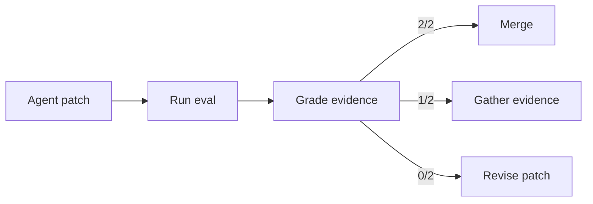
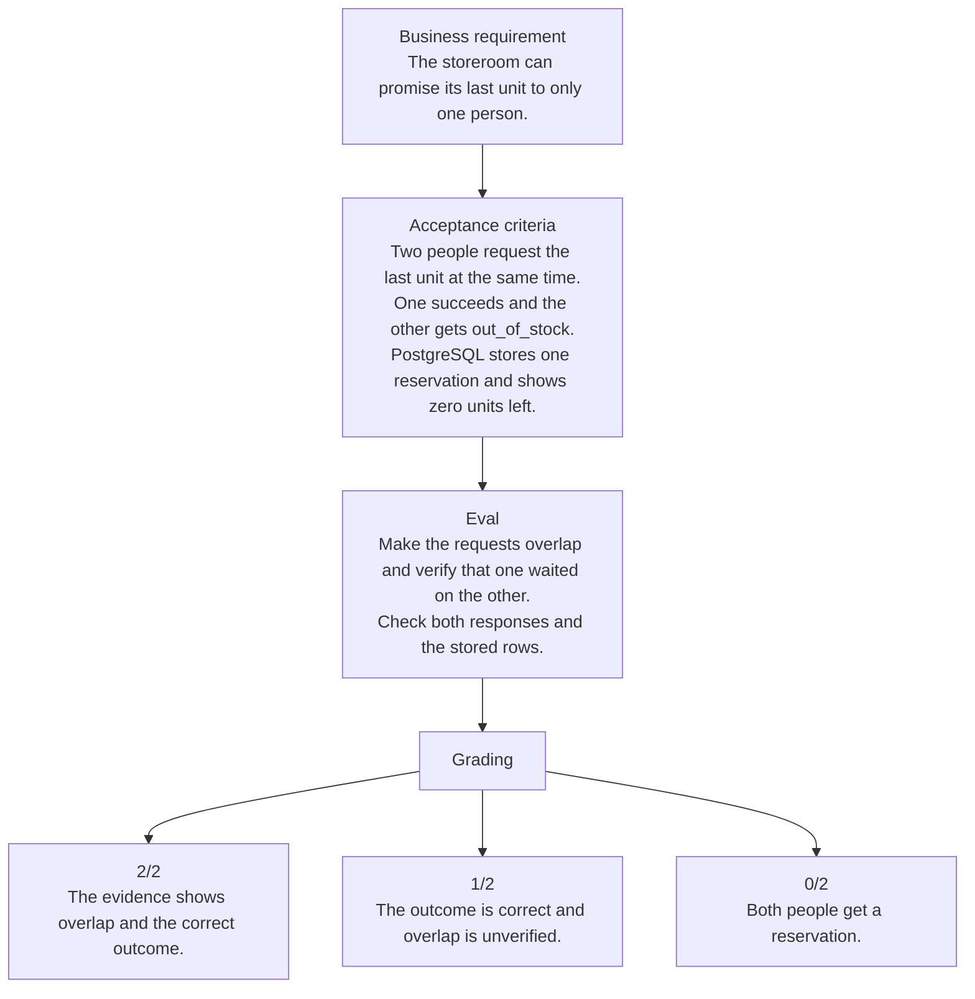

# Fieldstock · Inventory Reservation Lab

Fieldstock is a reference application for a small equipment storeroom. Staff reserve equipment. Administrators add stock and read a report. All sample records are synthetic.

This is independent, AI-assisted practice in writing requirements, building a reference implementation, and evaluating a candidate against the same rubric.

## Implementation status

The local reference is complete for the [assignment scope](docs/assignment.md). It includes a Next.js interface, TypeScript services, Tailwind CSS, PostgreSQL sessions and reservations, and an optional Redis report cache. PostgreSQL decides who gets the last unit. The integration test observes both requests contending for the same row.

## Architecture

### Software factory



### Fieldstock requirements and grading



## Run with Docker

From a clean clone with Docker and the Docker Compose plugin installed, run:

```sh
docker compose up --build --wait
```

Open [Fieldstock on localhost](http://127.0.0.1:3000). Sign in as `alice` or `bob` for staff, or `admin` for administrator. All three synthetic accounts use `demo-storeroom-2026`. The app seeds demo records on startup and PostgreSQL keeps data in a local volume.

The demo binds to loopback. Set `FIELDSTOCK_APP_PORT`, `FIELDSTOCK_POSTGRES_PORT`, or `FIELDSTOCK_REDIS_PORT` when the default ports 3000, 55432, or 56379 are in use. Stop the stack with `docker compose down`.

Run both implementations in an isolated Docker eval container using the [reproduction steps](evaluation/README.md#reproduce-with-docker).

## Run locally

Use Node.js 22.18 or later. On macOS or Linux, put the PostgreSQL 16 or later executables `initdb` and `pg_ctl` on `PATH`. Run as a regular user.

```sh
npm ci
npm run demo:local
```

Open [Fieldstock on localhost](http://127.0.0.1:3000). Sign in as `alice` or `bob` for staff, or `admin` for administrator. All three synthetic accounts use `demo-storeroom-2026`. The disposable database resets when you stop the demo.

To try caching, start Redis on a separate terminal. Then start the demo with the Redis URL.

```sh
redis-server --bind 127.0.0.1 --port 56379 --save "" --appendonly no
```

```sh
REDIS_URL=redis://127.0.0.1:56379 npm run demo:local
```

Open **Stock report** as an administrator. Reload within 30 seconds to see the Redis cache source. The inventory page still reads live stock from PostgreSQL.

### Use a host app with Docker services

```sh
cp .env.example .env.local
docker compose up -d --wait postgres redis
npm ci
npm run db:setup
npm run dev
```

The connection values in `.env.example` are for the synthetic localhost demo. If you override either service port, update the matching URL in `.env.local`. Keep any real connection URLs in an ignored `.env.local` or a secret store. For an HTTPS environment, set `SESSION_COOKIE_SECURE=true` and provision unique credentials. Stop the demo services with `docker compose down`.

## Verify

```sh
npm run typecheck
npm test
npm run build
npx playwright install chromium
npm run test:e2e
```

Both test commands create their own disposable PostgreSQL cluster. `npm test` prints the process IDs that prove the reservation writes overlapped and checks the committed rows. The browser suite runs the production build on port 3100. It exercises sign-in, personal history, an out-of-stock response, admin actions, and the report.

Run the browser suite with Redis to check the actual cache hit.

```sh
REDIS_URL=redis://127.0.0.1:56379 npm run test:e2e
```

Set `PLAYWRIGHT_CHANNEL=chrome` to use an installed Chrome browser. To test an outage, use an unused local Redis port and set `EXPECT_REDIS=false`.

## Training material

- [Assignment brief](docs/assignment.md) defines requirements, acceptance criteria, and exclusions.
- [Evaluation rubric](docs/rubric.md) defines scoring and the evidence needed for each criterion.
- [Reference solution](docs/reference-solution.md) explains the transaction, access checks, and Redis design.
- [Sample evaluation](evaluation/README.md) scores an AI-authored candidate, shows the defect, and verifies the correction.
- [Work log](docs/work-log.md) records observed results, AI assistance, and the project owner's review.
